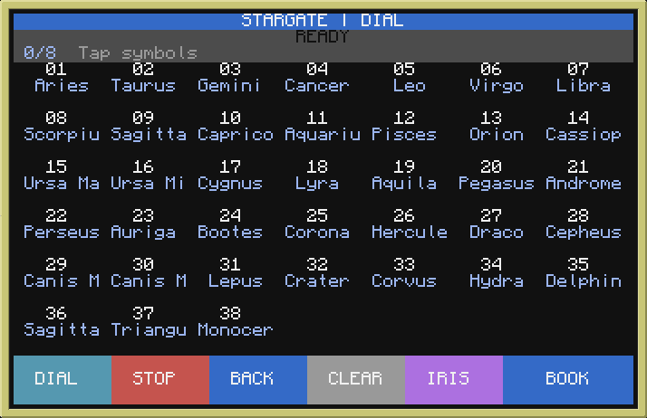
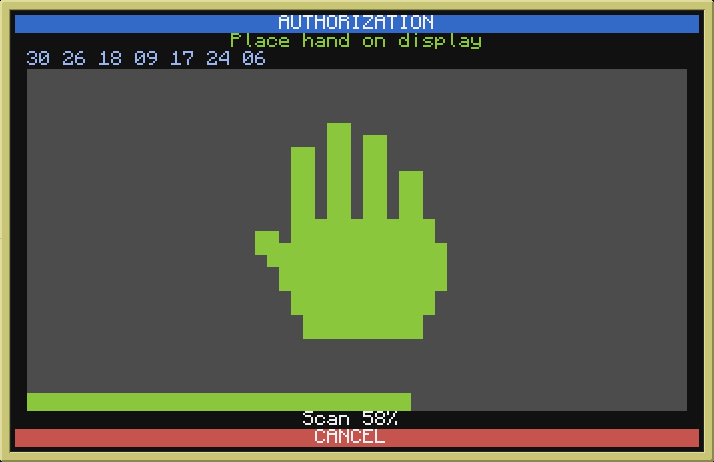
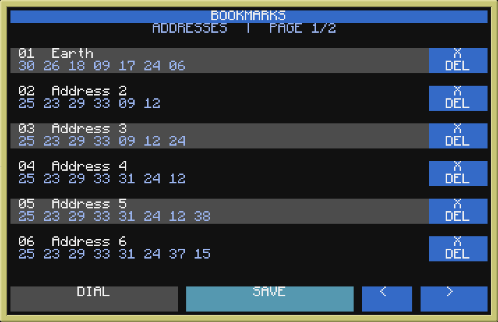
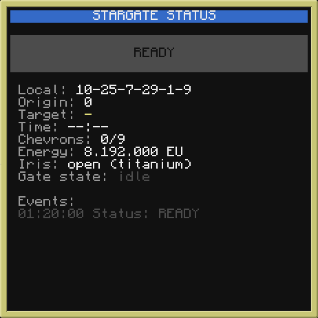
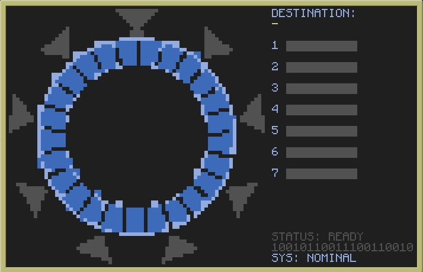
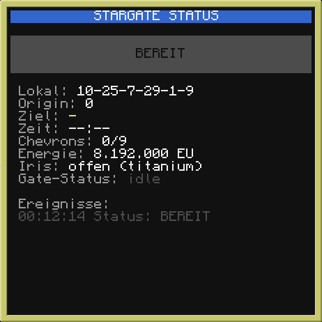
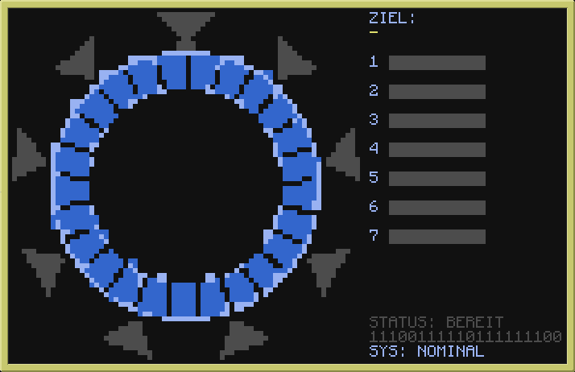

# Lantea: Stargates Gate Control

`sgcontrol.lua` is a touch control program for Lantea Stargates with CC:Tweaked. It provides a DHD for dialing addresses and can display gate status, iris state, and chevron progress.

This project is designed for [Lantea: Stargates](https://www.lantea.site/), also available on [CurseForge](https://www.curseforge.com/minecraft/mc-mods/lantea-stargates).

## Requirements

- Minecraft with CC:Tweaked and Lantea; the program is designed for Lantea 0.7.7.0.
- A computer connected to the Stargate peripheral. Connect it directly to the controller (a Coupler Kit is required) or through a Wired Modem.
- At least one connected monitor for the dialing menu. Status and chevron monitors are optional.
- The files `sgcontrol.lua` and `sg_language.lua` must be in the same ComputerCraft filesystem.

Pegasus gates are not supported. On first launch, `sg_config.lua` is created with all default values. Bookmarks are saved in `sg_bookmarks.lua`.

## Starting the Program

To install or update the program directly from GitHub, run this in the ComputerCraft shell:

```text
wget run https://raw.githubusercontent.com/HoodyBooti/L-S-Gate-Control/refs/heads/main/install.lua
```

The installer downloads `sgcontrol.lua` and `sg_language.lua`, then lets you choose the interface language, energy unit, and Stargate peripheral. The energy display can use EU or FE (1 EU = 4 FE). For each of the three monitor roles, press Enter for automatic discovery or enter the monitor number (for example, `10` becomes `monitor_10`). Existing configuration options are preserved. HTTP must be enabled in the CC:Tweaked server configuration.

In the ComputerCraft shell:

```text
sgcontrol
```

ComputerCraft can usually run Lua programs without the `.lua` extension. Alternatively, rename the file to `sgcontrol.lua`; the start command is then `sgcontrol`.

Useful arguments:

```text
sgcontrol identify
sgcontrol debug
sgcontrol probe
```

- `identify` displays peripheral names on all monitors for 15 seconds.
- `debug` enables verbose diagnostic messages for that run.
- `probe` also queries various gate methods and writes the results to `sg_debug.log`.
- Press `Ctrl+T` to stop the program.

If you start the program under a different name, use that name with the arguments as well.

## Monitors

The program assigns connected monitors to the `control`, `status`, and `chevron` roles in sorted name order. Each monitor can have only one role. You can assign peripheral names explicitly in `sg_config.lua`; an empty name (`""`) means automatic selection.

| Role | Contents | |
| --- | --- | --- |
| `controlMonitor` | Touch DHD, separate bookmark menu, iris and dialing controls |    |
| `statusMonitor` | Connection status, address, elapsed time, energy with fill percentage and bar (100% = 8,192,000 EU), iris, and event log |  |
| `chevronMonitor` | Stargate ring with chevron progress and an animated wormhole |  | 

For more screenshots in English and German, see the [picture gallery](pictures/readme.md).

If only one monitor is connected, it displays the dialing menu. To assign monitors explicitly, first run `<programname> identify`, then enter the names in the configuration.

## Controls

### Dialing Menu

- Tap a symbol to add it to the address. Selected symbols are highlighted in yellow.
- `DIAL` starts dialing. `STOP` aborts a dial or closes an outgoing connection.
- `BACK` removes the last symbol; `CLEAR` empties the address.
- `IRIS` opens or closes the iris, if the gate has one.
- `BOOK`, `LZ`, or `BM` opens the separate bookmark menu, depending on the language and monitor width.
- An address consists of 6 to 8 symbols. The Point of Origin (`00`) is appended automatically.

If hand-scan authorization is enabled, place your hand on the monitor or tap it repeatedly before dialing. The authorization method is configurable.

### Bookmarks

- An address with at least 6 symbols can be saved with `SAVE`.
- Tap a saved entry to load its address.
- `X` deletes an entry; tap the same button again to confirm.
- Use `<` and `>` to move between pages when there are many entries.
- New bookmarks are named automatically. You can also rename them in the ComputerCraft terminal.

Terminal commands while the program is running:

```text
list
name <No.> <Text>
del <No.>
```

## Configuration

`sg_config.lua` is created automatically and updated with any missing entries at each startup. You can edit the values there. Find monitor names with the `identify` command.

| Option | Default | Description |
| --- | --- | --- |
| `gate` | `""` | Stargate peripheral. If empty, the program searches for a Stargate automatically. |
| `controlMonitor` | `""` | Monitor for the dialing menu. If empty, one is selected automatically. |
| `statusMonitor` | `""` | Monitor for status information. If empty, one is selected automatically if a monitor is available. |
| `chevronMonitor` | `""` | Monitor for the chevron display. If empty, one is selected automatically if a monitor is available. |
| `autoScale` | `true` | Selects the largest suitable text scale and a matching DHD grid. |
| `controlScale` | `1` | Text scale for the dialing menu when `autoScale = false`. |
| `textScale` | `0.5` | Text scale for the status monitor. |
| `chevronScale` | `0.5` | Text scale for the chevron monitor. |
| `showNames` | `true` | Shows symbol names when the layout has room. |
| `minNameLen` | `6` | Minimum name length used by the adaptive layout. |
| `maxNameLen` | `12` | Maximum length of symbol names on the DHD. |
| `useGlyphs` | `false` | Uses available glyph images instead of numbers when the layout allows it. |
| `palmRequired` | `true` | Requires hand-scan authorization before every dial. |
| `palmMode` | `"hold"` | `"hold"` requires continuous contact; `"taps"` uses several quick touches. |
| `palmHoldSeconds` | `2.5` | Hold duration for `palmMode = "hold"`. |
| `palmTaps` | `5` | Number of touches for `palmMode = "taps"`. |
| `palmGap` | `0.8` | Maximum pause between touches before the scan restarts. |
| `palmTimeout` | `30` | Time in seconds before the authorization screen closes. |
| `pollInterval` | `0.25` | Interval between gate polls, in seconds. |
| `symbolTimeout` | `60` | Maximum time to wait for each symbol while dialing, in seconds. |
| `language` | `"DE"` | Interface language: `"DE"` or `"EN"`. |
| `energyInFE` | `false` | Displays energy in FE instead of EU. The conversion is 1 EU = 4 FE. |
| `debug` | `false` | Enables diagnostic output by default. |
| `debugTerminal` | `true` | Also prints diagnostic messages in the terminal. |
| `sidebar` | `false` | Deprecated option; bookmarks are always shown in a separate menu. |

Monitor roles can be assigned like this:

```lua
{
  controlMonitor = "monitor_0",
  statusMonitor = "monitor_1",
  chevronMonitor = "monitor_2",
  language = "EN",
}
```

The file is saved by `textutils.serialise`. It is best to edit existing values only and not replace the file with an arbitrary Lua configuration file.

## Languages

Language strings are stored in the `language.EN` and `language.DE` tables in `sg_language.lua`. Select the language with the `language` setting in `sg_config.lua`. To add a language, copy one of the table blocks, for example as `language.FR`, and translate the required text keys. Missing translations fall back to English.

Gate symbol names and technical values provided by the gate come from the Stargate peripheral and are not translated through the language file.

## Troubleshooting

For connection or dialing problems:

1. Check monitor names with `<programname> identify`.
2. If needed, set the gate peripheral explicitly with `gate`.
3. Start with `<programname> debug` and inspect `sg_debug.log`.
4. Run `<programname> probe` to log available gate queries and their return values.

---

# Lantea: Stargates Gate Control

`sgcontrol.lua` ist ein Touch-Steuerprogramm für Stargates aus Lantea mit CC:Tweaked. Es stellt ein DHD zur Adresswahl bereit und kann Gate-Status, Iris und Chevron-Wahl anzeigen.

Dieses Projekt wurde für [Lantea: Stargates](https://www.lantea.site/) entwickelt; die Mod ist auch auf [CurseForge](https://www.curseforge.com/minecraft/mc-mods/lantea-stargates) verfügbar.

## Voraussetzungen

- Minecraft mit CC:Tweaked und Lantea; das Programm ist für Lantea 0.7.7.0 ausgelegt.
- Ein Computer mit Verbindung zum Stargate-Peripheral. Der Computer kann direkt am Controller (Coupler Kit erforderlich) oder über ein Wired Modem angeschlossen sein.
- Mindestens ein angeschlossener Monitor für das Wahlmenü. Status- und Chevron-Monitore sind optional.
- Die Dateien `sgcontrol.lua` und `sg_language.lua` müssen im selben ComputerCraft-Dateisystem liegen.

Das Programm unterstützt keine Pegasus-Gates. Beim ersten Start wird `sg_config.lua` mit allen Standardwerten angelegt. Die Lesezeichen werden in `sg_bookmarks.lua` gespeichert.

## Starten

Zum Installieren oder Aktualisieren direkt von GitHub diesen Befehl in der ComputerCraft-Shell ausführen:

```text
wget run https://raw.githubusercontent.com/HoodyBooti/L-S-Gate-Control/refs/heads/main/install.lua
```

Das Installationsprogramm lädt `sgcontrol.lua` und `sg_language.lua` herunter und bietet anschliessend die Auswahl der Oberflächensprache, Energieeinheit und des Stargate-Peripherals an. Die Energieanzeige kann EU oder FE verwenden (1 EU = 4 FE). Für jede der drei Monitor-Rollen kann Enter für die automatische Erkennung gedrückt oder eine Monitor-Nummer eingegeben werden (zum Beispiel wird `10` zu `monitor_10`). Andere Konfigurationswerte bleiben erhalten. HTTP muss in der CC:Tweaked-Serverkonfiguration aktiviert sein.

In der ComputerCraft-Shell:

```text
sgcontrol
```

ComputerCraft kann Lua-Programme normalerweise ohne `.lua`-Endung starten. Alternativ kann die Datei in `sgcontrol.lua` umbenannt werden; dann lautet der Startbefehl `sgcontrol`.

Nützliche Argumente:

```text
sgcontrol identify
sgcontrol debug
sgcontrol probe
```

- `identify` zeigt die Peripheral-Namen auf allen Monitoren für 15 Sekunden an.
- `debug` schaltet für diesen Start ausführliche Diagnosemeldungen ein.
- `probe` fragt zusätzlich verschiedene Gate-Methoden ab und schreibt die Ergebnisse in `sg_debug.log`.
- Zum Beenden `Strg+T` drücken.

Wenn das Programm unter einem anderen Namen gestartet wird, diesen Namen auch für die Argumente verwenden.

## Monitore

Das Programm weist angeschlossene Monitore in sortierter Namensreihenfolge den Rollen `control`, `status` und `chevron` zu. Ein Monitor kann jeweils nur eine Rolle übernehmen. In `sg_config.lua` lassen sich die Peripheral-Namen fest zuweisen; ein leerer Name (`""`) bedeutet automatische Auswahl.

| Rolle | Inhalt | |
| --- | --- | --- |
| `controlMonitor` | Touch-DHD, separates Lesezeichenmenü, Iris- und Wahlsteürung |   |
| `statusMonitor` | Verbindungszustand, Adresse, Laufzeit, Energie mit Füllstand in Prozent und Balken (100 % = 8.192.000 EU), Iris und Ereignisprotokoll |  |
| `chevronMonitor` | Stargate-Ring mit Chevron-Fortschritt und animiertem Wurmloch |  | 

Falls nur ein Monitor angeschlossen ist, zeigt er das Wahlmenü. Für eine feste Zuordnung zürst `<programmname> identify` ausführen und danach die Namen in der Konfiguration eintragen.

## Bedienung

### Wahlmenü

- Ein Symbol antippen, um es zur Adresse hinzuzufügen. Ausgewählte Symbole werden gelb markiert.
- `WAHL` (`DIAL` auf Englisch) startet die Wahl. `STOP` bricht eine Wahl ab oder schliesst eine ausgehende Verbindung.
- `ZUR.` (`BACK`) entfernt das letzte Symbol; `CLR` (`CLEAR`) leert die Adresse.
- `IRIS` öffnet oder schliesst die Iris, falls das Gate eine Iris besitzt.
- `BOOK`, `LZ` oder `BM` öffnet das separate Lesezeichenmenü (je nach Sprache und Monitorbreite).
- Eine Adresse besteht aus 6 bis 8 Symbolen. Der Point of Origin (`00`) wird automatisch angehängt.

Ist der Handscan aktiviert, muss vor dem Wählen die Hand auf dem Monitor gehalten oder mehrfach angetippt werden. Die Art der Freigabe lässt sich konfigurieren.

### Lesezeichen

- Eine Adresse mit mindestens 6 Symbolen kann über `SAVE` gespeichert werden.
- Ein gespeicherter Eintrag lädt die Adresse durch Antippen.
- `X` löscht einen Eintrag; zur Bestätigung denselben Knopf erneut antippen.
- Bei vielen Einträgen blättern `<` und `>` durch die Seiten.
- Neü Lesezeichen erhalten automatisch einen Namen. Namen lassen sich auch im ComputerCraft-Terminal ändern.

Terminalbefehle während das Programm läuft:

```text
list
name <Nr> <Text>
del <Nr>
```

## Konfiguration

`sg_config.lua` wird automatisch erzeugt und bei jedem Start um fehlende Einträge ergänzt. Werte können dort angepasst werden. Monitor-Namen findest du mit dem `identify`-Befehl.

| Option | Standard | Bedeutung |
| --- | --- | --- |
| `gate` | `""` | Stargate-Peripheral. Leer sucht automatisch nach einem Stargate. |
| `controlMonitor` | `""` | Monitor für das Wahlmenü. Leer wählt automatisch. |
| `statusMonitor` | `""` | Monitor für Statusinformationen. Leer wählt automatisch, sofern noch ein Monitor frei ist. |
| `chevronMonitor` | `""` | Monitor für die Chevron-Grafik. Leer wählt automatisch, sofern noch ein Monitor frei ist. |
| `autoScale` | `trü` | Wählt die grösste passende Textskalierung und ein passendes DHD-Raster. |
| `controlScale` | `1` | Textskalierung für das Wahlmenü, wenn `autoScale = false` ist. |
| `textScale` | `0.5` | Textskalierung des Statusmonitors. |
| `chevronScale` | `0.5` | Textskalierung des Chevron-Monitors. |
| `showNames` | `trü` | Zeigt Symbolnamen an, wenn das Layout Platz bietet. |
| `minNameLen` | `6` | Kürzeste Namenslänge, die das adaptive Layout verwendet. |
| `maxNameLen` | `12` | Maximale Länge von Symbolnamen im DHD. |
| `useGlyphs` | `false` | Verwendet verfügbare Glyphenbilder statt Nummern, wenn das Layout passt. |
| `palmRequired` | `trü` | Verlangt vor jeder Wahl eine Freigabe per Handscan. |
| `palmMode` | `"hold"` | `"hold"` verlangt kontinuierliches Halten; `"taps"` nutzt mehrere schnelle Touches. |
| `palmHoldSeconds` | `2.5` | Haltedaür für `palmMode = "hold"`. |
| `palmTaps` | `5` | Anzahl der Touches für `palmMode = "taps"`. |
| `palmGap` | `0.8` | Maximale Pause zwischen Touches, bevor der Scan neu beginnt. |
| `palmTimeout` | `30` | Zeit in Sekunden, nach der sich die Freigabeansicht schliesst. |
| `pollInterval` | `0.25` | Abstand zwischen Gate-Abfragen in Sekunden. |
| `symbolTimeout` | `60` | Maximale Wartezeit pro Symbol beim Wählen in Sekunden. |
| `language` | `"DE"` | Sprache der Oberfläche: `"DE"` oder `"EN"`. |
| `energyInFE` | `false` | Zeigt die Energie statt in EU in FE an. Umrechnung: 1 EU = 4 FE. |
| `debug` | `false` | Aktiviert Diagnoseausgaben daürhaft. |
| `debugTerminal` | `trü` | Gibt Diagnosemeldungen zusätzlich im Terminal aus. |
| `sidebar` | `false` | Veraltete Option; Lesezeichen erscheinen immer nur im separaten Menü. |

Monitor-Rollen lassen sich zum Beispiel so festlegen:

```lua
{
  controlMonitor = "monitor_0",
  statusMonitor = "monitor_1",
  chevronMonitor = "monitor_2",
  language = "DE",
}
```

Die Datei wird von `textutils.serialise` gespeichert. Daher am besten nur bestehende Werte bearbeiten und die Datei nicht durch eine beliebige Lua-Konfigurationsdatei ersetzen.

## Sprachen

Die Sprachtexte liegen in `sg_language.lua` in den Tabellen `language.EN` und `language.DE`. Die Sprache wird über `language` in `sg_config.lua` ausgewählt. Um eine Sprache hinzuzufügen, einen der Tabellenblöcke kopieren, etwa als `language.FR`, und die benötigten Textschlüssel übersetzen. Nicht übersetzte Einträge fallen auf Englisch zurück.

Gate-Symbolnamen und vom Gate gelieferte technische Werte stammen aus dem Stargate-Peripheral und werden nicht aus der Sprachdatei übersetzt.

## Diagnose

Bei Verbindungs- oder Wahlproblemen:

1. Mit `<programmname> identify` Monitor-Namen prüfen.
2. Bei Bedarf Gate-Peripheral über `gate` fest eintragen.
3. Mit `<programmname> debug` starten und `sg_debug.log` ansehen.
4. Mit `<programmname> probe` verfügbare Gate-Abfragen und Rückgaben protokollieren.

