# Picture Gallery

## English

| Dialing screen | Dialing screen with authorization | Bookmarks |
| --- | --- | --- |
| 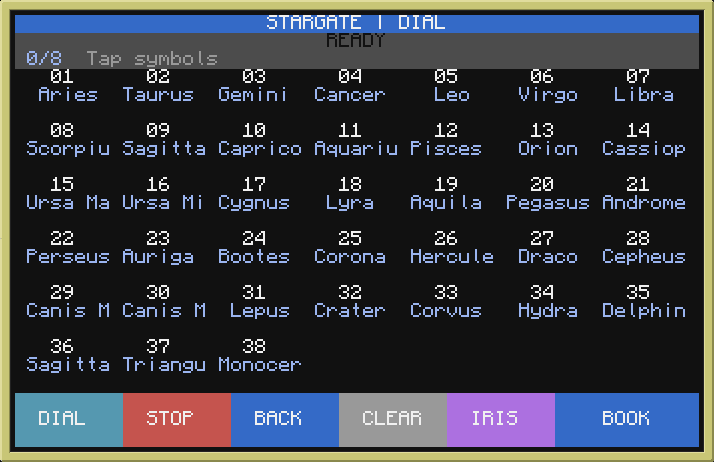 | 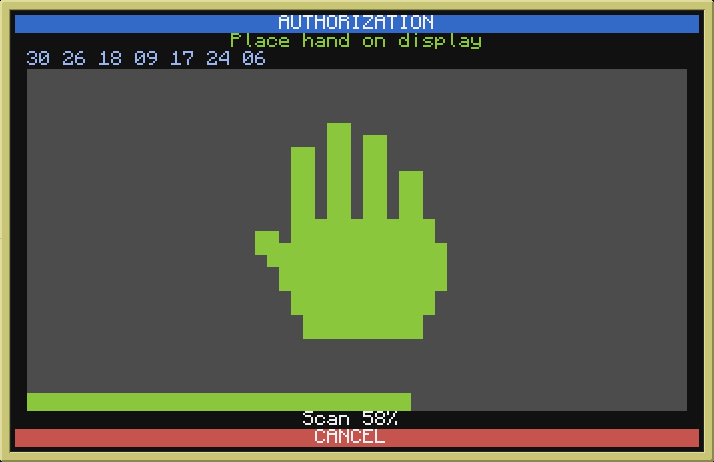 | 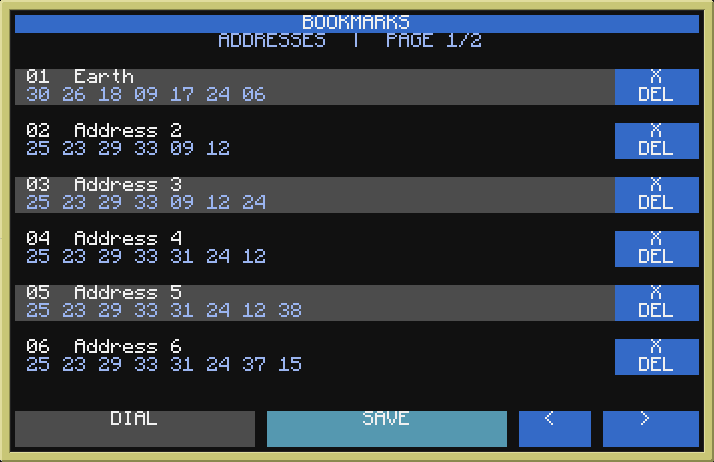 |

| Status | Status while dialing | Chevron display |
| --- | --- | --- |
| 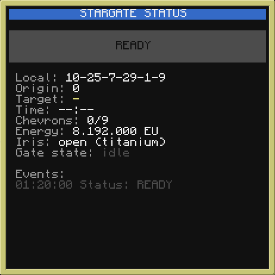 | 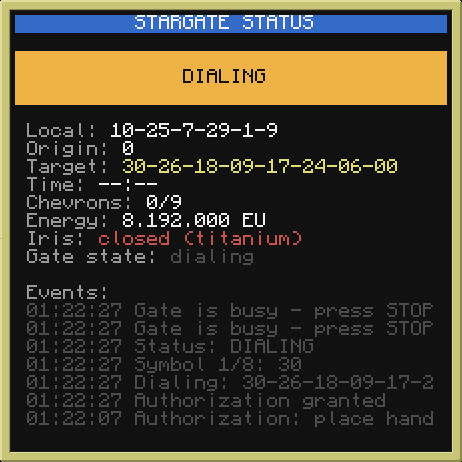 | 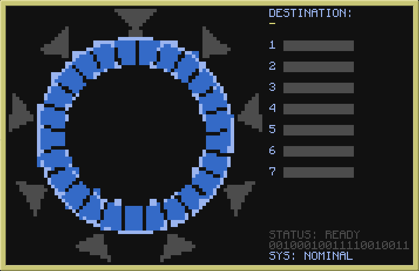 |

| Chevron display while dialing | Animated chevron display | Terminal |
| --- | --- | --- |
| 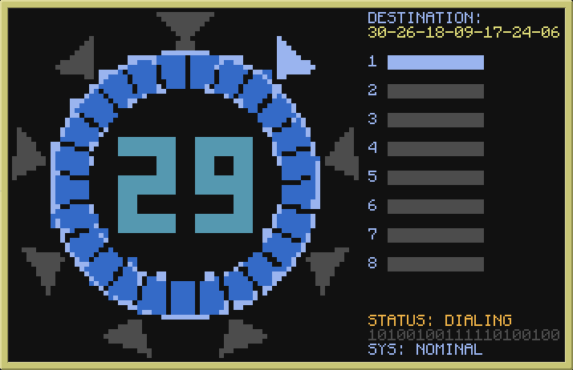 | 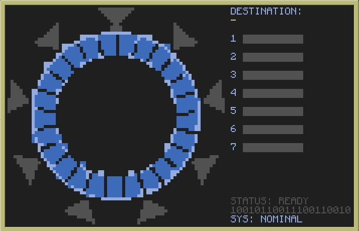 | 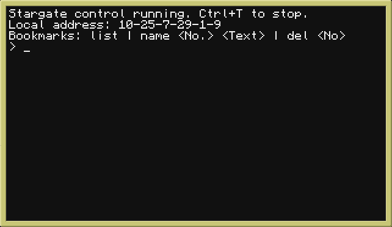 |

## Deutsch

| Wahlmenü | Lesezeichen | Status |
| --- | --- | --- |
|  | 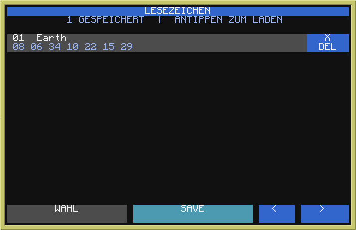 | 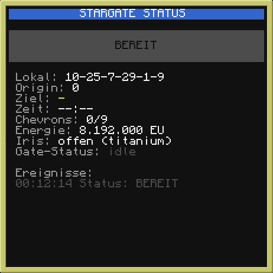 |

| Chevron-Anzeige |
| --- |
| 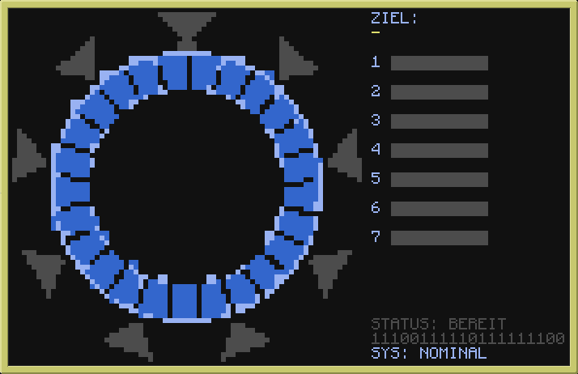 |
